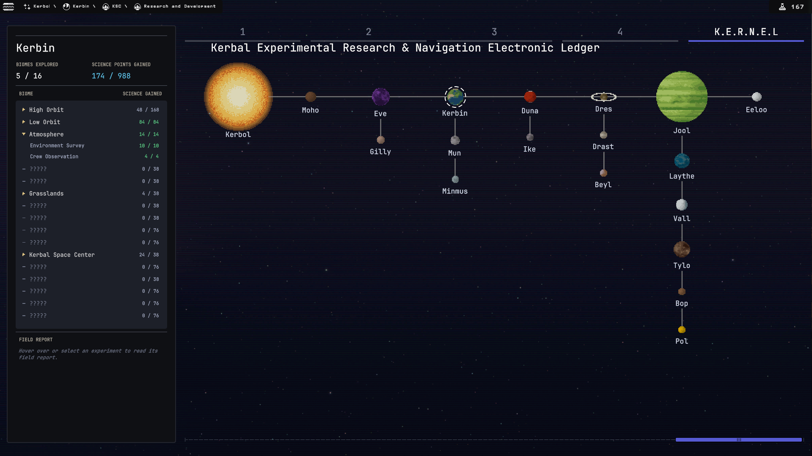
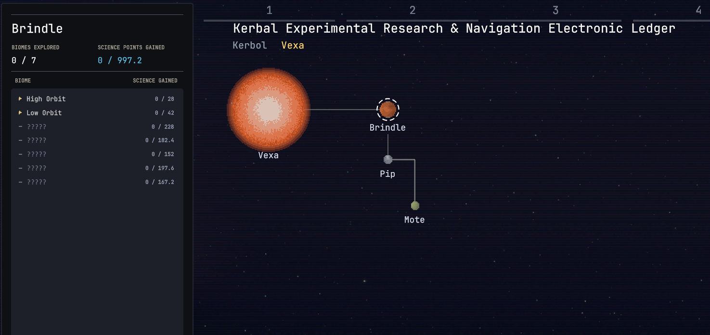
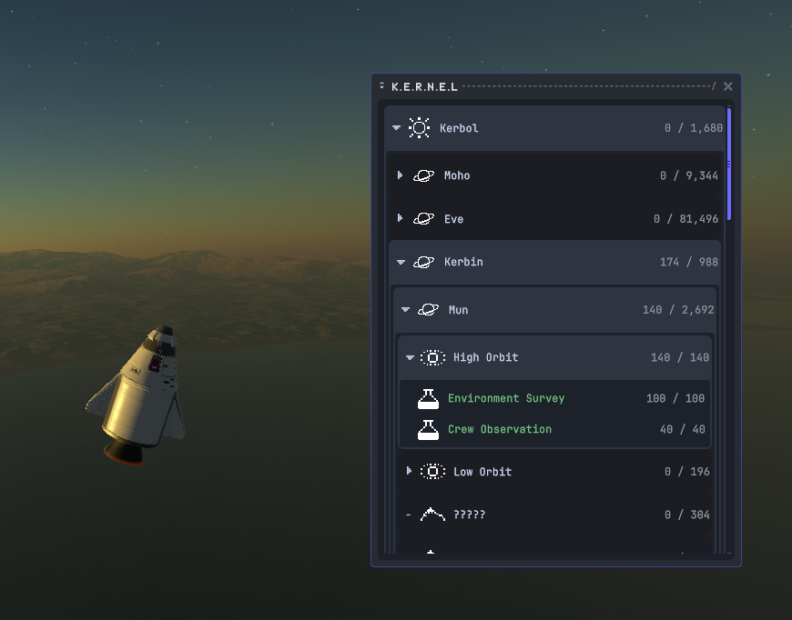
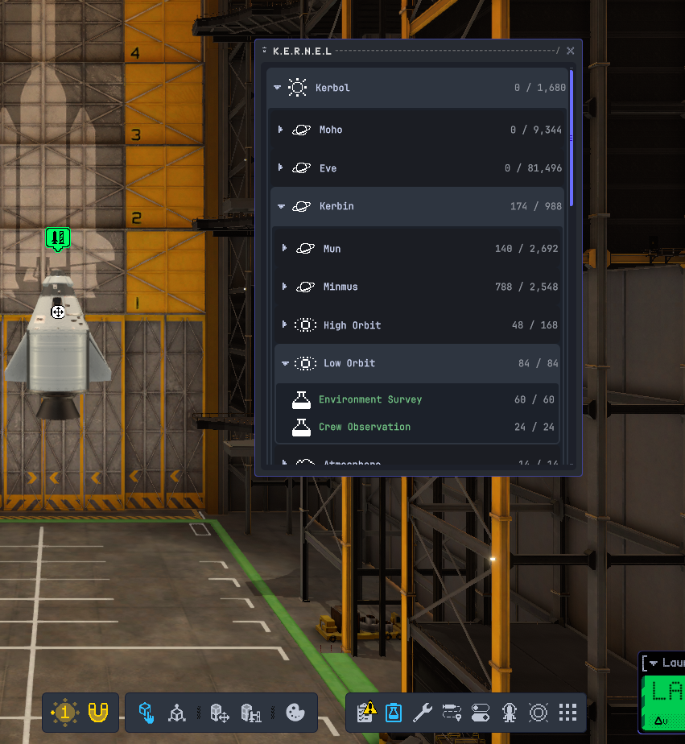

# K.E.R.N.E.L

**Kerbal Experimental Research & Navigation Electronic Ledger**: a science tracker for [KSP2 Redux](https://github.com/KSP2Redux/Redux).

> 🚧 Pre-release (0.1.0): early, but working. Please report problems on the [issues page](https://github.com/BillMeabrod/KERNEL/issues).

## What it does

K.E.R.N.E.L keeps a ledger of every science experiment in your career.

- **Ledger window.** Open it from the toolbar in flight or in the VAB to browse experiments by celestial body and science region, and see what you've completed and where there's still science to gather.
- **R&D page.** A K.E.R.N.E.L tab after the tech tiers slides the tree away to a starfield with a pixel-art map of the solar system. Pick a planet or moon to see its biomes and experiments in the sidebar, and the field report each experiment came back with.
- **Modded planets.** Bodies added by planet mods appear on the map and in the ledger, with art generated from their own textures, rings from their ring data, and suns tinted by their star's light.
- **Spoiler protection.** Biomes you haven't visited show as "?????" and experiments you haven't unlocked are hidden. Turn on **Show spoilers** in the game's settings, on the K.E.R.N.E.L page, to see everything.

## Screenshots

*The R&D page: the whole solar system on one map. Kerbin is selected, so the sidebar lists its biomes and the science gathered in each, with "?????" for biomes not yet visited.*

*Modded planets: a second star gets its own system in the picker along the top, tinted by its light. Its planet, moon and moon of a moon are drawn from their own textures, with their science in the sidebar.*

*The ledger window in flight: every body, region and experiment in one tree, with the science gathered out of what's available at each level.*

*The ledger window in the VAB, opened from its own button on the toolbar, to check what science is left before you build.*

## Requirements

- Kerbal Space Program 2 with [KSP2 Redux](https://github.com/KSP2Redux/Redux) installed

## Installing

1. Download `KERNEL.zip` from the [releases page](https://github.com/BillMeabrod/KERNEL/releases).
2. Extract it into your game's `mods` folder (`Kerbal Space Program 2\mods\`). It contains a `KERNEL` folder, so you end up with `mods\KERNEL\`.

## Credits

Inspired by [Science Arkive](https://github.com/Kerbalight/ScienceArkive) by leonardfactory. K.E.R.N.E.L is a from-scratch rewrite for Redux, not a port of its code.

## License

[MIT](LICENSE)
